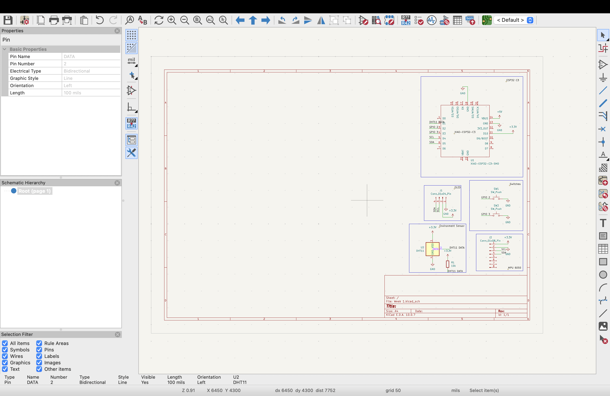
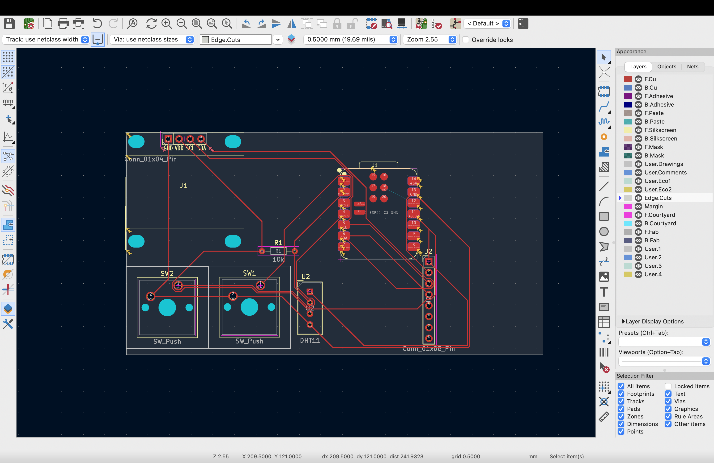

# Screaminbanana's Starbie!
This is my submission to Week 1 of the Hack Club YSWS Half Life.
This is a small circuit board with the capability to detect button presses, movement, and environment temp/humidity. 
To make it I followed the guide on Half Life, I also strayed from it sometimes, but it's mostly a starbie.
You can find the BOM in the repo: [BOM.md](BOM.md).
If you would like to see my journal as I made this incredible piece of technology, please check out [JOURNAL.md](JOURNAL.md).
Anyway, here are some photos of the design:

If you decide to make this, I hope you like it!
